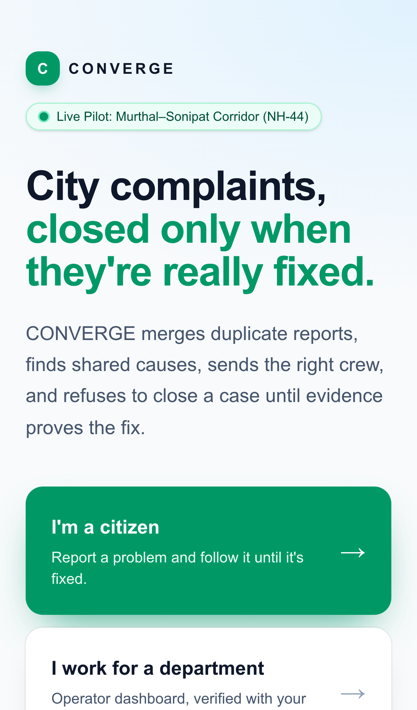
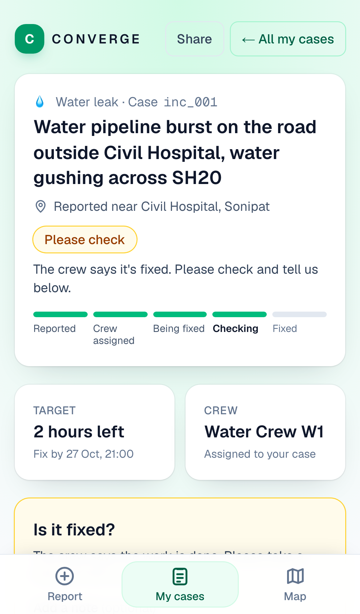
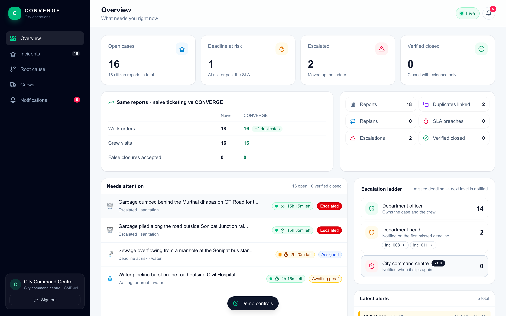
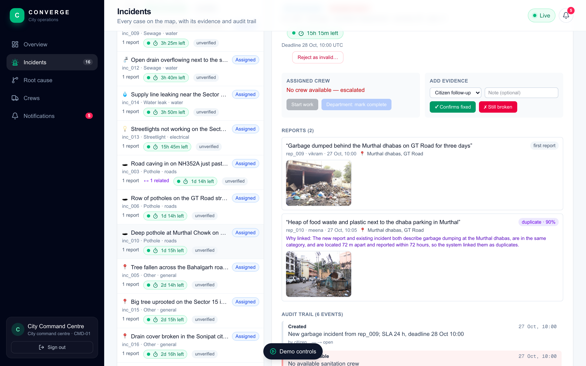
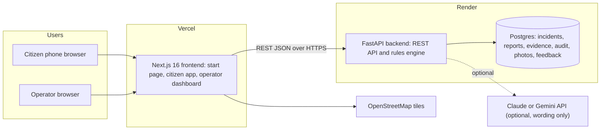
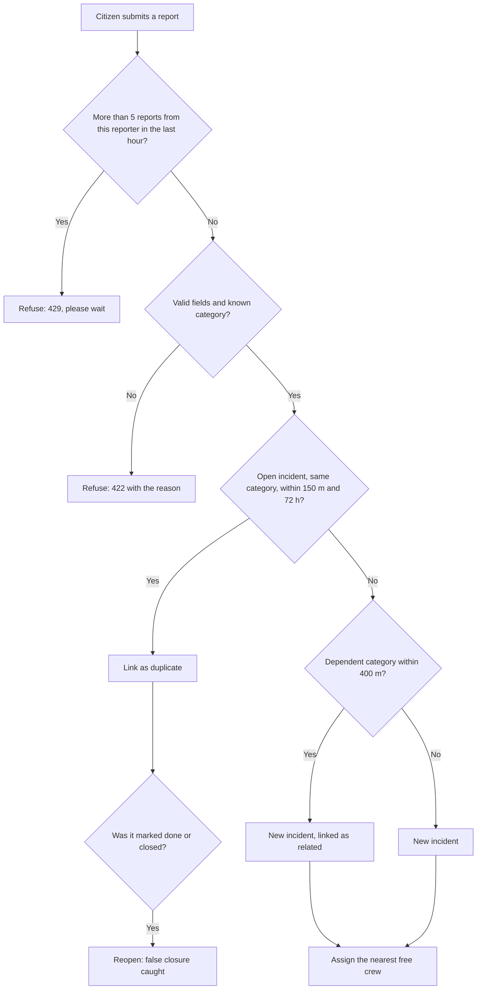
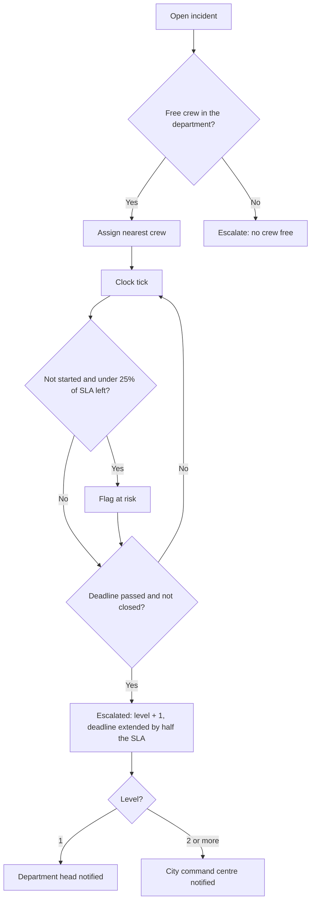
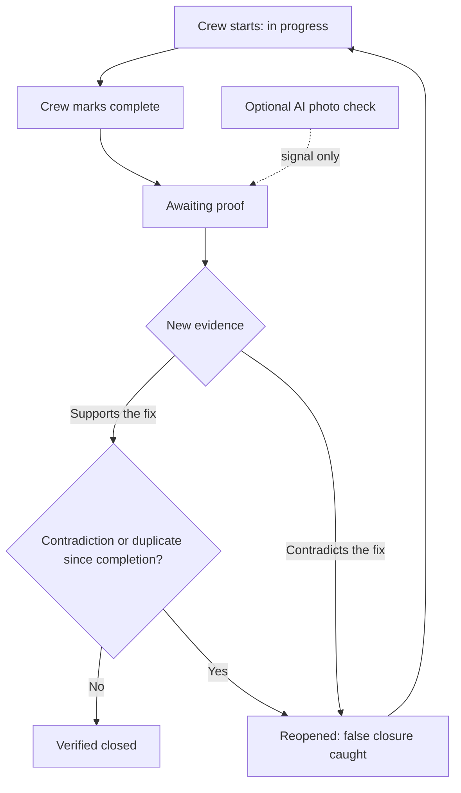
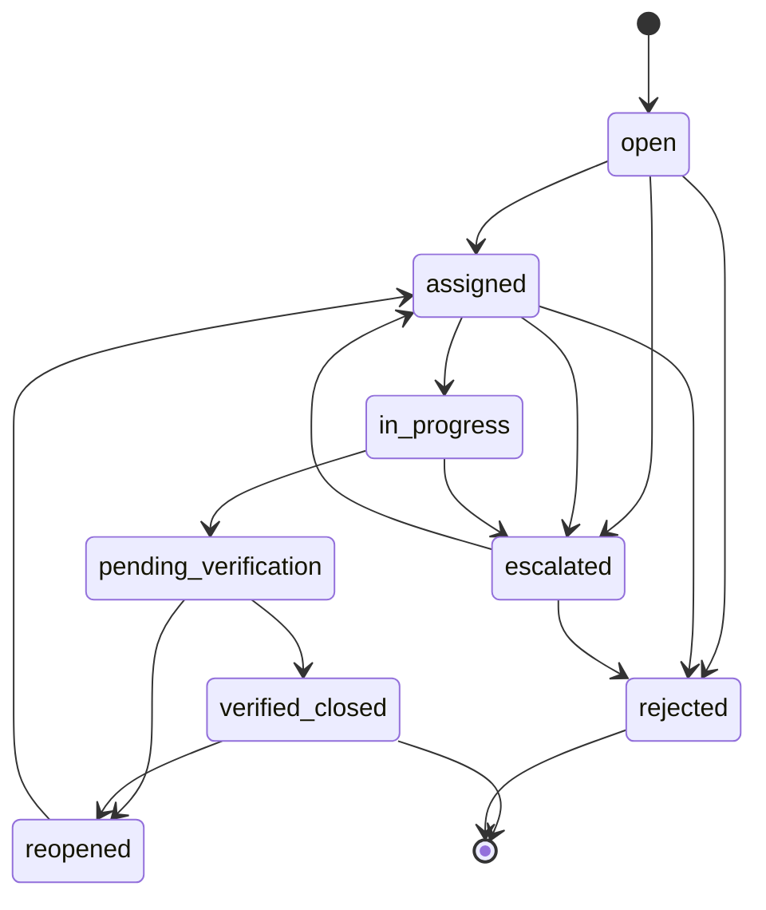

# CONVERGE

**City complaints, closed only when they're really fixed.**

CONVERGE is a civic complaint platform built for the *Smart Cities: From Citizen Reports to Verified
Resolution* problem statement. Citizens report problems from their phones. CONVERGE groups duplicate
reports, links problems that share a cause, assigns the right crew, watches every deadline, escalates
when one slips, and closes a case only when evidence proves the fix. Every decision is made by plain
rules in code and written to an audit trail.

| | |
|---|---|
| **Live app** (citizens and operators) | https://converge-web-ten.vercel.app |
| **Operator dashboard** | https://converge-web-ten.vercel.app/operator |
| **Backend health check** | https://converge-backend-hnp0.onrender.com/health |
| **Demo operator login** | badge `CMD-01`, access code `command-demo-2026` (city command centre) |
| **Pilot area** | Murthal–Sonipat, Haryana (GT Road / NH-44) |

> **Demo credentials only.** Sign-in sessions last for the browser tab, and the API itself is not
> locked down. Production authentication is on the roadmap.

| Citizen start page | Citizen case page |
|---|---|
|  |  |





Screenshots are from the live site with the Murthal–Sonipat pilot data.

---

## Contents

1. [Try it in 60 seconds](#1-try-it-in-60-seconds)
2. [The problem](#2-the-problem)
3. [What CONVERGE does](#3-what-converge-does)
4. [How it works: diagrams](#4-how-it-works-diagrams)
5. [The rules, with their numbers](#5-the-rules-with-their-numbers)
6. [Using the app](#6-using-the-app)
7. [Tech stack](#7-tech-stack)
8. [Project structure](#8-project-structure)
9. [Setup: run it locally](#9-setup-run-it-locally)
10. [Configuration](#10-configuration)
11. [API reference](#11-api-reference)
12. [Data model](#12-data-model)
13. [Demo scenarios](#13-demo-scenarios)
14. [Testing](#14-testing)
15. [Deployment](#15-deployment)
16. [Team workflow](#16-team-workflow)
17. [Security, privacy and limits](#17-security-privacy-and-limits)
18. [Troubleshooting](#18-troubleshooting)
19. [Roadmap](#19-roadmap)
20. [Docs index](#20-docs-index)
21. [Team, credits and licence](#21-team-credits-and-licence)

---

## 1. Try it in 60 seconds

1. Open https://converge-backend-hnp0.onrender.com/health and wait for `{"ok":true}`. The backend runs
   on a free host that sleeps when idle, so the first request can take about a minute.
2. Open https://converge-web-ten.vercel.app and choose **I'm a citizen**. Sign in with any first name
   and an email (the email never leaves your browser). Report a problem with a photo or a map pin,
   then open your case.
3. In a second window, open https://converge-web-ten.vercel.app/operator and sign in as `CMD-01` /
   `command-demo-2026`. Your complaint pops up on screen and is listed on the **Incidents** tab.
4. Back on your case page, answer **Still broken** with a note. The operator sees it straight away.
   The case cannot close until evidence supports the fix.

## 2. The problem

> **Problem statement.** Create a platform that processes citizen complaints, identifies duplicate and
> related incidents, assigns work across departments, and tracks service-level deadlines. When a
> department misses a deadline or evidence contradicts a closure report, the system must reopen or
> escalate the case and coordinate the next steps.

Most city complaint systems fail in three ways:

- **One ticket per report.** Ten people report the same burst pipe, and the city opens ten tickets.
- **"Done" means closed.** A crew says *fixed*, and the ticket closes, even if the water is still running.
- **Deadlines slip quietly.** Nobody is told when a case is late, so nothing moves up the chain.

CONVERGE treats *work order complete* and *issue resolved* as different things.

## 3. What CONVERGE does

| Capability | What the code does |
|---|---|
| **Groups reports** | A repeat report of the same category within 150 m and 72 h becomes a **duplicate** of the open incident: no new work order. A connected problem within 400 m (a leak under a road) becomes **related**. |
| **Finds shared causes** | Related incidents form a **hypothesis** with the most upstream incident as the cause. An operator confirms or rejects it. Confirmed: one repair covers the whole group, and the demo cuts crew visits from 3 to 1. |
| **Assigns and replans** | The nearest free crew in the right department. If a crew becomes unavailable, its jobs are reassigned automatically (`plan_version` goes up). |
| **Enforces deadlines** | Each category has an SLA. Cases not started with under 25% of their SLA left are flagged **at risk**. A missed deadline escalates: department officer → department head → city command centre. |
| **Verifies the fix** | "Done" means *awaiting proof*. A case closes only on supporting evidence with no contradiction since completion. A citizen saying "still broken" reopens it (a **false closure caught**). |
| **Resists fake reports** | Trust badges (unverified, corroborated, confirmed on site), a reject action for department heads and the command centre, and a limit of 5 reports per reporter per hour. |
| **Citizen photos and location** | Photos (up to 5 MB, type-checked) and GPS or a pin dropped on the map. Photos are stored and shown to operators. |
| **Keeps citizens in the loop** | A phone app: report, My cases, a nearby-issues map, and a public case page with status, deadline, crew and timeline. |
| **Alerts operators** | New complaints and citizen evidence pop up on every operator tab and are listed on the Incidents tab. |
| **Audits everything** | Every state change writes an audit event with actor, reason and evidence. |
| **Measures itself** | `/metrics` compares CONVERGE with a naive system (one work order per report, every "done" accepted). |
| **AI, optional** | Claude Haiku or Gemini can rewrite link explanations and give an advisory photo check. **AI never decides a status.** It is off in the live demo. |

## 4. How it works: diagrams

All flowcharts, including the roadmap ones, are in [docs/FLOWS.md](docs/FLOWS.md). The key ones are below.

### 4.1 System architecture



### 4.2 One report, end to end

```mermaid
sequenceDiagram
  participant C as Citizen phone
  participant W as Next.js app
  participant A as FastAPI API
  participant E as Rules engine
  participant D as Database
  participant O as Operator dashboard
  C->>W: Report with photo and location
  W->>A: POST /reports
  A->>E: Rate limit, validate, group, assign
  E->>D: Save report, incident and audit events
  A-->>W: Incident and any duplicate or related link
  O->>A: Poll incidents and citizen activity every few seconds
  A-->>O: New complaint: pop-up and Incidents tab
  C->>A: POST evidence: Still broken, with a note
  A->>E: Verification rules
  E->>D: Reopen if it was marked done; audit false_closure_detected
  O->>A: Next poll shows the change
```

### 4.3 Report intake and grouping



### 4.4 Deadlines and escalation



### 4.5 Verification and closure



### 4.6 Incident states



`pending_verification` is shown to users as **Awaiting proof**. `rejected` needs a department head or
the command centre, with a reason: `fake`, `not_civic`, `cannot_locate` or `duplicate_elsewhere`.

## 5. The rules, with their numbers

All values live in `backend/app/config.py` and `backend/app/engine/`.

| Rule | Value |
|---|---|
| Duplicate | Same category, within **150 m**, within **72 h** of an open incident |
| Related | Dependent categories within **400 m**: water leak ↔ pothole, sewage ↔ water leak, sewage ↔ pothole |
| Upstream order (shared cause) | sewage, then water leak, then pothole |
| SLA hours | water leak **12**, sewage **12**, streetlight **24**, garbage **24**, pothole **48**, other **72** |
| At risk | Not started and under **25%** of the SLA left |
| Missed deadline | Escalation level + 1, deadline extended by **half the SLA** |
| Escalation ladder | Level 1 → department head; level 2+ → city command centre |
| Closure | Supporting evidence, and no contradicting evidence or duplicate report since completion |
| Trust badge | `confirmed_on_site` (inspector or human photo evidence) > `corroborated` (2+ reporters, or photo with GPS) > `unverified` |
| Rate limit | **5** reports per reporter per rolling hour (`429`) |
| Photos | JPEG, PNG, WebP or GIF, up to **5 MB**; the bytes must match the declared type |
| Reject | Department heads and the command centre only; officers get `403` |
| AI | Optional. Writes wording and an advisory photo check. Never changes a status. |

## 6. Using the app

**Start page (`/`).** Asks *Who are you?* and sends you to the citizen app or the operator portal.

**Citizen app (`/citizen`)**, built as an installable phone web app with a bottom bar:

- **Report** (`/citizen`): describe the problem, pick a category, add a photo, and set the location by
  GPS, a nearby landmark, or by dropping a pin on the map.
- **My cases** (`/citizen/cases`): cases reported from this phone, with live status. Cases that need
  your check come first.
- **Map** (`/citizen/map`): open issues near you. Tap one for *Me too* or *View case*, or drop a pin to
  report a new spot.
- **Case page** (`/track/<id>`): public, so shared links work without signing in. It shows status, the
  deadline, the crew, a timeline, and **Is it fixed? Yes / Still broken** with an optional note.

Install on a phone: on iPhone (Safari) use Share → Add to Home Screen; on Android (Chrome) use
menu → Install app. There is no offline mode: the app always shows live data.

**Operator portal (`/operator`)**, after a badge and access code:

- **Overview:** open cases, deadlines at risk, escalations, verified closures, the naive-vs-CONVERGE
  table, the escalation ladder, and the latest alerts.
- **Incidents:** the queue, the street map, the citizen activity list, and the case detail: reports
  with photos, evidence, audit trail, crew, and actions (start, complete, add evidence, reject).
- **Root cause:** shared-cause hypotheses with evidence for and against, to confirm or reject.
- **Crews:** availability; marking a crew unavailable triggers replanning.
- **Notifications:** escalations and alerts.
- **Demo controls:** the scripted scenarios and a simulated clock (+1 h, +12 h, +48 h).

## 7. Tech stack

| Layer | Technology | Version | Purpose |
|---|---|---|---|
| Frontend framework | Next.js (App Router, Turbopack) | 16.4.3 | Pages, routing, builds |
| UI library | React | 19.3.0 | Components |
| Language | TypeScript | 5 | Type safety |
| Styling | Tailwind CSS | 4 | Styles |
| Maps | Leaflet + react-leaflet | 1.9.4 / 5.0.0 | Street map, citizen map, pins |
| Map tiles | OpenStreetMap | — | Free tiles, no API key |
| Icons | lucide-react | 1.16.0 | Icons |
| Package manager | pnpm | 12.15 | Frontend dependencies |
| Backend framework | FastAPI + Uvicorn | latest | REST API |
| ORM | SQLModel (SQLAlchemy + Pydantic) | latest | Models and queries |
| Database | SQLite (local), Postgres (live) | — | Storage; `psycopg` driver for Postgres |
| AI (optional) | Anthropic `claude-haiku-5-5` or Google `gemini-3.8-flash` | — | Wording and advisory photo check |
| Backend runtime | Python | 3.13 (Docker) | Backend |
| Backend tests | pytest + httpx | — | Unit, rule, scenario and invariant tests |
| End-to-end tests | Python Playwright | — | Browser checks of the demo and citizen flow |
| Frontend hosting | Vercel | — | Static and server-rendered pages |
| Backend hosting | Render (Docker web service + Postgres) | free plan | API and database |
| Collaboration | GitHub, `CHANNEL.md` | — | PRs and the team message board |

## 8. Project structure

```text
converge_trojans/
├── backend/
│   ├── app/
│   │   ├── main.py            # every HTTP route
│   │   ├── config.py          # categories, SLAs, radii, dependent pairs, at-risk share
│   │   ├── models.py          # database tables
│   │   ├── db.py              # engine, sessions, reset (keeps feedback)
│   │   ├── sim.py             # simulated clock and demo scenarios
│   │   ├── auth.py            # demo operator and citizen sign-in
│   │   ├── engine/            # the rules
│   │   │   ├── intake.py      # new reports
│   │   │   ├── dedup.py       # duplicate and related matching
│   │   │   ├── assign.py      # crew assignment and replanning
│   │   │   ├── sla.py         # deadlines, at risk, escalation
│   │   │   ├── ladder.py      # officer → head → command centre
│   │   │   ├── verify.py      # evidence and closure
│   │   │   ├── rootcause.py   # shared-cause hypotheses (v2)
│   │   │   ├── hierarchy.py   # parent and child incidents
│   │   │   ├── trust.py       # trust badges, reject, rate limit
│   │   │   ├── photos.py      # photo checks and storage
│   │   │   ├── impact.py      # affected city services
│   │   │   ├── feedback.py    # tester ratings
│   │   │   ├── metrics.py     # CONVERGE vs naive baseline
│   │   │   ├── audit.py       # audit events
│   │   │   ├── geo.py         # distances
│   │   │   └── llm.py         # optional AI wording and photo signal
│   │   └── seed/              # crews, services, operators, city dataset, sample photos
│   ├── tests/                 # pytest suite and scenario fixtures
│   ├── requirements.txt
│   ├── Dockerfile
│   └── .env.example
├── frontend/
│   ├── src/app/               # pages: /, /citizen, /citizen/cases, /citizen/map, /track/[id], /operator
│   ├── src/components/        # dashboard, citizen app, maps, panels, sheets
│   ├── src/lib/               # API client, types, formatting, sessions
│   └── public/                # icons and the web app manifest
├── scripts/                   # e2e.py, e2e_citizen_flow.py, smoke.sh
├── docs/                      # contracts, flows, architecture, demo, pitch, testing
├── team/                      # each person's folder and presenter notes
├── render.yaml                # Render Blueprint
├── AGENTS.md                  # instructions for AI assistants
├── CHANNEL.md                 # team message board
└── TEAM_GUIDE.md              # plain-language guide
```

## 9. Setup: run it locally

**Prerequisites**

- Python 3.13 or newer, with `venv`
- Node.js 24 and pnpm 12 (`corepack enable` gets the pinned pnpm)
- git
- Optional: Docker, for running the backend image

**1. Get the code**

```bash
git clone https://github.com/srtkio/converge_trojans.git
cd converge_trojans
```

**2. Backend** (port 8001; port 8000 is often taken)

```bash
cd backend
python3 -m venv .venv && source .venv/bin/activate
pip install -r requirements.txt
cp .env.example .env            # optional; edit values, never commit it
uvicorn app.main:app --reload --port 8001
```

Check it: http://localhost:8001/health should return `{"ok":true}`. The first start creates a SQLite
database at `backend/converge.db` and seeds crews, services and operators.

**3. Frontend** (port 3000)

```bash
cd frontend
pnpm install
echo "NEXT_PUBLIC_API_URL=http://localhost:8001" > .env.local
pnpm dev
```

Open http://localhost:3000.

**4. Load demo data**

Sign in at http://localhost:3000/operator as `CMD-01` / `command-demo-2026`, open **Demo controls**, press
**Reset**, then **Next step** to walk through a scenario. Or from the command line:

```bash
curl -X POST http://localhost:8001/sim/reset
curl -X POST "http://localhost:8001/sim/scenario/golden?step=10"   # full v1 demo
curl -X POST "http://localhost:8001/sim/scenario/city"             # Murthal–Sonipat pilot data
```

**Optional: backend with Docker**

```bash
cd backend
docker build -t converge-backend .
docker run -p 8001:8000 -e CONVERGE_CORS_ORIGINS=http://localhost:3000 converge-backend
```

**Optional: install on a phone over your LAN.** Installing needs HTTPS. Use the live site, or run
`next dev --experimental-https` and add your LAN origin to `CONVERGE_CORS_ORIGINS`.

## 10. Configuration

Backend settings go in `backend/.env` locally, or in the Render dashboard. Never commit them.

| Variable | Default | What it does |
|---|---|---|
| `CONVERGE_DB_URL` | `sqlite:///./converge.db` | Database URL. Postgres URLs work too. |
| `CONVERGE_CORS_ORIGINS` | `http://localhost:3000` | Comma-separated frontend origins allowed to call the API. |
| `CONVERGE_CORS_ORIGIN_REGEX` | — | Optional origin pattern, e.g. `https://.*\.vercel\.app`. |
| `CONVERGE_LLM` | `on` | `off` disables AI wording even when a key is set. |
| `CONVERGE_LLM_PROVIDER` | — | `anthropic` or `gemini`, to force one when both keys are set. |
| `ANTHROPIC_API_KEY` | — | Enables Claude Haiku wording and photo signal. |
| `GEMINI_API_KEY` | — | Enables Gemini wording and photo signal. |
| `GEMINI_MODEL` | `gemini-3.8-flash` | Gemini model name. |

Frontend: `NEXT_PUBLIC_API_URL` (in `frontend/.env.local`) is the backend URL. It is baked in at build
time, so redeploy the frontend after changing it.

Without any AI key, CONVERGE uses its rule-based wording. Everything works.

## 11. API reference

JSON over HTTP. IDs carry a prefix (`inc_`, `rep_`, `res_`, `ev_`, `aud_`). Times are ISO-8601 UTC on
a simulated clock. The full contract is in [docs/CONTRACTS.md](docs/CONTRACTS.md).

| Method | Path | Purpose |
|---|---|---|
| GET | `/health` | Liveness check |
| POST | `/reports` | Submit a citizen report (text, category, location, optional photo) |
| GET | `/incidents` | List incidents (`?status=` to filter) |
| GET | `/incidents/{id}` | Incident with reports, links, evidence, audit and crew |
| POST | `/incidents/{id}/start` | Crew starts work |
| POST | `/incidents/{id}/complete` | Crew marks complete → awaiting proof |
| POST | `/incidents/{id}/evidence` | Add evidence (inspector, photo, sensor, citizen follow-up) |
| POST | `/incidents/{id}/reject` | Reject as invalid (heads and command centre only) |
| GET | `/incidents/{id}/impact` | City services affected by the incident |
| GET | `/photos/{id}` | A stored report photo |
| GET | `/resources` | Crews and their availability |
| POST | `/resources/{id}/unavailable` | Crew drops out → replanning |
| POST | `/resources/{id}/available` | Crew back → waiting incidents assigned |
| GET | `/services` | City services (transport, schools, health) |
| GET | `/hypotheses` | Shared-cause hypotheses |
| POST | `/hypotheses/{id}/confirm` | Confirm a shared cause |
| POST | `/hypotheses/{id}/reject` | Reject a shared cause |
| GET | `/citizen/activity` | Citizen complaints and follow-ups, newest first |
| POST | `/auth/citizen` | Citizen sign-in (name and email; only the first name is used) |
| POST | `/auth/operator` | Operator sign-in with badge and access code |
| GET | `/operators/ladder` | The escalation ladder and who sits where |
| POST | `/feedback` | Submit a tester rating |
| GET | `/feedback` | All feedback |
| GET | `/feedback/summary` | Count, average, distribution, by role, recent comments |
| GET | `/metrics` | CONVERGE vs naive baseline |
| GET | `/audit` | Audit events (`?incident_id=` to filter) |
| GET | `/sim/clock` | Simulated time |
| POST | `/sim/tick` | Advance the clock (`?minutes=`) |
| POST | `/sim/reset` | Clear demo data and reseed (feedback is kept) |
| GET/POST | `/sim/scenario/golden` | v1 demo (`?step=1..10`) |
| GET/POST | `/sim/scenario/rootcause` | v2 demo (`?step=1..8`) |
| GET/POST | `/sim/scenario/city` | Pilot-area dataset (`?step=1..7`) |

## 12. Data model

| Entity | Key fields |
|---|---|
| **Report** | id, text, category, location, reporter (first name only), photo, created_at, incident_id |
| **Incident** | id, title, category, department, location, severity (1–5), status, deadline, assigned crew, plan_version, escalation_level, report ids, related ids, parent and children, verification badge, at-risk flag |
| **Link** | report, incident, kind (`duplicate` or `related`), reason, confidence |
| **Resource** (crew) | id, name, department, available, location, active incidents |
| **Evidence** | id, incident, kind (`photo`, `sensor`, `citizen_followup`, `inspector`), supports_resolution, note, source, signal_only |
| **Hypothesis** | id, cause incident, members, evidence for and against, confidence, status |
| **AuditEvent** | id, incident, actor, event type, from and to status, detail, evidence ids, timestamp |
| **Feedback** | rating 1–5, role, comment, created_at (kept across resets) |

## 13. Demo scenarios

The demo runs on a simulated clock, so deadlines and escalations can be shown in minutes. Use the
**Demo controls** on the operator dashboard, or the `/sim/scenario/*` endpoints.

**v1 · Verified loop (10 steps)**: a water leak is reported and assigned; a second report becomes a
duplicate; a nearby pothole becomes related; the crew drops out and the case escalates; the crew
returns and marks it complete; the citizen says it is still leaking and the case reopens; it is
repaired and the inspector's photo closes it; the clock jumps 49 hours and the untouched pothole
breaches its SLA; the scorecard compares CONVERGE with a naive system.

**v2 · Root cause (8 steps)**: three related complaints; CONVERGE proposes one shared cause; an operator
confirms it; one repair covers all three, and crew visits drop from 3 to 1; each child still needs its
own proof before closing.

**City dataset (7 steps)**: 18 complaints across the Murthal–Sonipat pilot area, with photos, for user
testing and the map. Not used for pitch numbers.

Presenter scripts: [docs/DEMO.md](docs/DEMO.md) (clicks) and [docs/PRESENTATION_SCRIPT.md](docs/PRESENTATION_SCRIPT.md) (on stage).

## 14. Testing

```bash
cd backend && pytest                          # unit, rule, scenario, invariant and trust tests
cd frontend && pnpm lint && pnpm build        # lint and production build
python3 scripts/e2e.py --base http://localhost:3000             # full demo in a browser
python3 scripts/e2e_citizen_flow.py --base http://localhost:3000  # citizen report reaches the operator
CONVERGE_URL=http://localhost:8001 scripts/smoke.sh               # quick API check of the v1 scenario
```

- **pytest** covers every rule in the contract, the v1, v2 and city scenarios against a stored
  baseline, sign-in and roles, photos, feedback, and randomised invariant tests that run thousands of
  random operations and check that no rule is ever broken.
- **`scripts/e2e.py`** signs in, runs v1 to step 10 and v2 to step 8 through the buttons, checks the
  comparison tables, and checks the citizen case page at iPhone size for overflow and console errors.
- **`scripts/e2e_citizen_flow.py`** uses two browsers: a citizen files a complaint and answers "Still
  broken"; the operator must see both, with the first name only and no email.
- E2E needs `pip install playwright && playwright install chromium`.

Against the live site, pass `--base https://converge-web-ten.vercel.app`. These create demo data, so
reset afterwards (`POST /sim/reset`); the reset keeps tester feedback.

## 15. Deployment

**Backend on Render.** `render.yaml` is a Blueprint: a Docker web service built from
`backend/Dockerfile`, plus a free Postgres database so feedback survives restarts. In the Render
dashboard: New → Blueprint → this repo. Set any AI keys there, and add the Vercel URL to
`CONVERGE_CORS_ORIGINS`. Render redeploys on changes to `backend/`.

**Frontend on Vercel.** Build from `frontend/` with `NEXT_PUBLIC_API_URL` set to the Render URL.

**Before a demo:** open `/health` and wait for it, because the free plan sleeps after about 15
minutes idle.

## 16. Team workflow

- **One branch per change:** `feat/…`, `fix/…`, `docs/…`. Open a pull request into `main`.
- **The user merges.** AI assistants open and review pull requests but do not merge them.
- **Never force-push** `main` or a shared branch. To update a branch, merge `main` into it.
- **Before a pull request:** pytest, lint, build, and both e2e scripts must pass.
- **`CHANNEL.md`** is the shared message board for people and AI assistants. Read it before starting;
  add one line after each meaningful step.
- **`AGENTS.md`** tells any AI assistant the rules, owners and current status.
- **`TEAM_GUIDE.md`** is the plain-language guide for the team.
- **Secrets** never go into git: no `.env`, keys or passwords. Demo sign-in codes are the exception
  and are labelled demo-only.

## 17. Security, privacy and limits

- **Sign-in is demo-grade.** Sessions last for the browser tab. Operator codes are stored as SHA-256
  hashes. The sign-in protects the screens only; the API is open.
- **Citizens:** only the first name is kept with a report. The email is never stored or shown.
- **Photos:** limited to 5 MB and to real image types, so `/photos` never serves anything else.
- **Rate limit:** 5 reports per reporter per hour.
- **AI:** optional, off in the live demo, and never decides a status.
- **Map:** covers the pilot area, not the whole city.
- **Hosting:** the free backend sleeps when idle.

## 18. Troubleshooting

| Problem | Fix |
|---|---|
| The live site shows no data or spins | The backend is asleep. Open `/health` and wait about a minute. |
| Browser console shows a CORS error | Add your frontend origin to `CONVERGE_CORS_ORIGINS` and restart the backend. |
| Port 8000 already in use | Run the backend on 8001 and set `NEXT_PUBLIC_API_URL` to match. |
| Black page or stale styles in dev | Delete `frontend/.next` and restart `pnpm dev`. |
| Backend errors about missing columns after an update | Delete the local `backend/converge.db` and restart; it is recreated and reseeded. |
| AI wording never appears | Expected without a key, or with `CONVERGE_LLM=off`. |
| E2E scripts fail to sign in | Check the backend is awake and the demo badge is `CMD-01` or `OPS-WTR-01`. |

## 19. Roadmap

**Built and live:** the v1 verified loop, v2 shared-cause repair, the v3 citizen app with photos and
location, the operator hierarchy and alerts, trust badges and rejection, and the Murthal–Sonipat pilot.

**Designed, not built** (flowcharts in [docs/FLOWS.md](docs/FLOWS.md)):

- More complaint domains on the same engine, such as healthcare services and bin overflow
- A water network module: sensor anomalies, fault hypotheses, repair verification
- A food redistribution module: surplus matching, expiry-aware delivery
- A healthcare administration module: referrals and follow-ups, administrative only
- Cross-domain coordination: one disruption, joint plans across water, roads, food and health
- Production authentication and an API that enforces roles

## 20. Docs index

| Document | What it covers |
|---|---|
| [docs/FLOWS.md](docs/FLOWS.md) | Twelve flowcharts: six implemented, six roadmap |
| [docs/CONTRACTS.md](docs/CONTRACTS.md) | Data model, rules, API, demo location (frozen contract) |
| [docs/ARCHITECTURE.md](docs/ARCHITECTURE.md) | System design |
| [docs/PRD.md](docs/PRD.md) | Product requirements |
| [docs/ROADMAP.md](docs/ROADMAP.md) | Versions and plans |
| [docs/DEMO.md](docs/DEMO.md) | Click-by-click demo |
| [docs/PRESENTATION_SCRIPT.md](docs/PRESENTATION_SCRIPT.md) | On-stage script |
| [docs/PITCH.md](docs/PITCH.md) | Pitch slides and numbers |
| [docs/TESTING.md](docs/TESTING.md) | User testing with six people |
| [TEAM_GUIDE.md](TEAM_GUIDE.md) | Plain-language team guide |
| [AGENTS.md](AGENTS.md) | Rules for AI assistants |
| [CHANNEL.md](CHANNEL.md) | Team message board |

## 21. Team, credits and licence

**Team**

- **Sarthak** (`srtkio`): lead, operator dashboard, integration, deploys, pitch
- **Prachi** (`Prachivats-21`): backend engine, citizen app
- **Antriksh** (`Antrikshcodes`): presenter, demo driver, QA
- **Poorvi** (`poorvig222`): presenter, research, market, results

**Credits**

- Map tiles © OpenStreetMap contributors; maps by Leaflet.
- Sample photos and their licences: [backend/app/seed/photos/ATTRIBUTION.md](backend/app/seed/photos/ATTRIBUTION.md).
- Built with FastAPI, SQLModel, Next.js, React, Tailwind CSS and lucide-react.

**Licence:** MIT. See [LICENSE](LICENSE).
