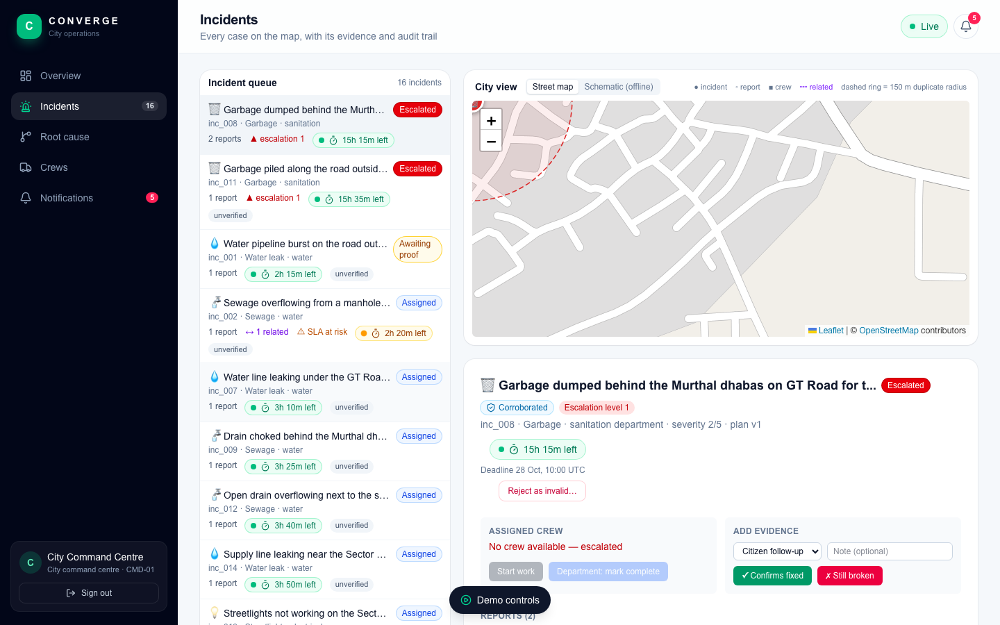
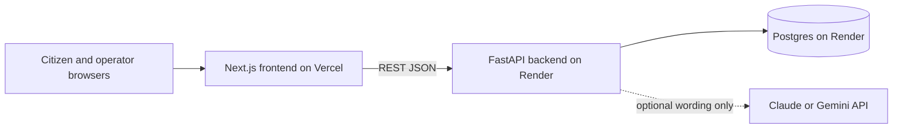

# CONVERGE

**City complaints, closed only when they're really fixed.**

CONVERGE is a civic complaint platform. It groups duplicate reports, assigns crews, enforces
deadlines, and closes a case only when evidence backs the fix. Every decision is written to an audit
trail.

- **App (citizens and operators):** https://converge-web-ten.vercel.app
- **Operator dashboard:** https://converge-web-ten.vercel.app/operator
- **Backend health:** https://converge-backend-hnp0.onrender.com/health (open this first; the free host sleeps)
- **Demo operator login:** badge `CMD-01`, access code `command-demo-2026` (city command centre, all departments)

> Demo credentials only. Sessions are per browser tab, and the API is not locked down. Production
> auth is planned for v2.

| Citizen start page | Citizen case page |
|---|---|
|  |  |




Screenshots are from the live site with the Murthal–Sonipat pilot data.

**Contents:** [Try it](#try-it-in-60-seconds) · [The problem](#the-problem) ·
[What CONVERGE does](#what-converge-does) · [Pilot area](#pilot-area) · [Architecture](#architecture) ·
[Run locally](#run-it-locally) · [Tests](#tests) · [Demo accounts](#demo-accounts) · [Deploy](#deploy) ·
[Roadmap](#roadmap) · [Docs](#docs) · [Team](#team)

## Try it in 60 seconds

1. Open https://converge-backend-hnp0.onrender.com/health and wait for `{"ok":true}`. The first
   request can take about a minute while the free host wakes up.
2. Open https://converge-web-ten.vercel.app and choose **I'm a citizen**. Sign in with any first name,
   report a problem with a photo or a map pin, and open your case.
3. In a second window, open https://converge-web-ten.vercel.app/operator and sign in as `CMD-01` /
   `command-demo-2026`. The new complaint pops up, and it is listed on the **Incidents** tab.
4. Back on the case page, answer **Still broken** with a note. The operator sees it straight away.
   No case closes until evidence supports the fix.

## The problem

Most city systems open one ticket per report, close a ticket when a department says "done", and let
deadlines slip quietly. A crew that says "fixed" closes the case, even if the water is still running.

## What CONVERGE does

| Capability | What the code does |
|---|---|
| Groups reports | A repeat report within 150 m and 72 h becomes a **duplicate** of the existing incident. A connected problem within 400 m (a leak under a road) becomes **related**. |
| Finds shared causes (v2) | Related incidents form a **hypothesis**. An operator confirms it, and one repair covers all of them. The demo cuts crew visits from 3 to 1. |
| Assigns and replans | The nearest free crew in the right department. If a crew drops out, its jobs are reassigned automatically. |
| Enforces deadlines | Each category has an SLA (water leak and sewage 12 h, streetlight and garbage 24 h, pothole 48 h). Missed deadlines escalate: officer → department head → city command centre. |
| Checks the fix | "Done" means *awaiting proof*. A citizen saying "still broken" reopens the case. It closes only on supporting evidence. |
| Stops fake reports | Trust badges (unverified, corroborated, confirmed on site), a reject action for department heads and the command centre, and a per-reporter rate limit. |
| Citizen photos and location | Citizens can attach a photo and a GPS or pinned location. Photos are stored and shown to operators. |
| AI, optionally | Claude Haiku or Gemini can write the link explanations and an advisory photo check. **AI never decides a status.** It is off in the live demo. |

Every step lands in the audit trail, and the metrics compare CONVERGE with a naive ticketing system.

## Pilot area

The live demo covers **Murthal–Sonipat, Haryana**: Murthal Chowk on GT Road (NH-44), the Murthal
dhabas, Bahalgarh, the Sonipat bus stand and railway junction, Civil Hospital, and Rishihood
University. The map is OpenStreetMap, and the demo data is in `backend/app/seed/`.

## Architecture



- **Frontend:** Next.js 16 (App Router), React 19, TypeScript, Tailwind CSS 4, Leaflet maps.
- **Backend:** Python, FastAPI, SQLModel. Rules live in `backend/app/engine/`.
- **Database:** SQLite locally, Postgres on Render. Feedback survives resets.
- **Flows:** intake, assignment, verification, the state machine, shared-cause repair and the citizen loop are drawn in [docs/FLOWS.md](docs/FLOWS.md).

## Run it locally

Backend (port 8001; 8000 is often taken):

```bash
cd backend
python3 -m venv .venv && source .venv/bin/activate
pip install -r requirements.txt
uvicorn app.main:app --port 8001
```

Frontend (port 3000):

```bash
cd frontend
pnpm install
NEXT_PUBLIC_API_URL=http://localhost:8001 pnpm dev
```

Open http://localhost:3000. The start page asks who you are. Operators sign in at `/operator`.
Press **Reset**, then **Next step →** to run the 10-step golden scenario.

Optional AI: put `ANTHROPIC_API_KEY` or `GEMINI_API_KEY` in `backend/.env` (see
`backend/.env.example`). Without a key, the rule text is used. Never commit `.env`.

## Tests

```bash
cd backend && pytest                                  # unit, invariant and scenario tests
cd frontend && pnpm lint && pnpm build
python3 scripts/e2e.py --base http://localhost:3000   # the whole demo in a browser
python3 scripts/e2e_citizen_flow.py --base http://localhost:3000   # citizen files, operator sees it
```

`scripts/e2e.py` runs the v1 and v2 scenarios and checks the comparison tables. The second script
checks that a citizen's report and evidence reach the operator, with first name only.

## Demo accounts

Demo only. Operator codes are stored as SHA-256 hashes in `backend/app/seed/operators.json`.

| Badge | Access code | Who |
|---|---|---|
| `OPS-WTR-01` | `water-demo-2026` | Water department officer |
| `OPS-RDS-01` | `roads-demo-2026` | Roads department officer |
| `HEAD-WTR-01` | `water-head-2026` | Water department head (can reject water complaints as invalid) |
| `HEAD-RDS-01` | `roads-head-2026` | Roads department head (can reject roads complaints) |
| `CMD-01` | `command-demo-2026` | City command centre, all departments |

Citizens sign in with a name and email at `/citizen`. Only the first name is stored with a report.

## Deploy

- **Backend:** Render Blueprint (`render.yaml`): Docker web service plus a free Postgres. Set
  `GEMINI_API_KEY` or `ANTHROPIC_API_KEY` in the Render dashboard, not in git.
- **Frontend:** Vercel, with `NEXT_PUBLIC_API_URL` set to the Render URL at build time.
- Add the Vercel URL to `CONVERGE_CORS_ORIGINS` on the backend.
- The Render free plan sleeps when idle. Open `/health` before a demo.

## Roadmap

Built and live: the v1 verified loop, v2 shared-cause repair, the v3 citizen loop with photos and
location, operator hierarchy, and the pilot-area data.

Next: the water, food and healthcare-administration modules and cross-domain coordination are
designed in [docs/FLOWS.md](docs/FLOWS.md) and [docs/ROADMAP.md](docs/ROADMAP.md). They are roadmap
items, not built features.

## Docs

- [docs/FLOWS.md](docs/FLOWS.md): twelve flowcharts: six implemented (A1–A6, with the real rule values) and six roadmap (B–G)
- [docs/CONTRACTS.md](docs/CONTRACTS.md): data model, rules and API (the frozen contract)
- [docs/ARCHITECTURE.md](docs/ARCHITECTURE.md), [docs/PRD.md](docs/PRD.md), [docs/ROADMAP.md](docs/ROADMAP.md)
- [docs/DEMO.md](docs/DEMO.md) and [docs/PRESENTATION_SCRIPT.md](docs/PRESENTATION_SCRIPT.md): the demo
- [docs/TESTING.md](docs/TESTING.md): user testing with six people
- [TEAM_GUIDE.md](TEAM_GUIDE.md): plain-language guide for the team
- [AGENTS.md](AGENTS.md): instructions for AI assistants working in this repo
- [CHANNEL.md](CHANNEL.md): the team's message board

## Team

- **Sarthak** (`srtkio`): lead, dashboard, integration, deploys, pitch
- **Prachi** (`Prachivats-21`): backend engine, citizen app
- **Antriksh** (`Antrikshcodes`): presenter, demo driver, QA
- **Poorvi** (`poorvig222`): presenter, research, market, results

## Credits

- Map tiles: © OpenStreetMap contributors. Maps: Leaflet.
- Sample photos and their licences: [backend/app/seed/photos/ATTRIBUTION.md](backend/app/seed/photos/ATTRIBUTION.md).
- Built with FastAPI, Next.js, React, Tailwind CSS and SQLModel.
