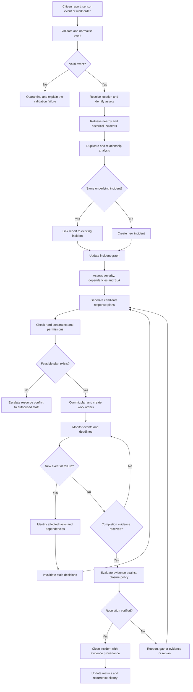
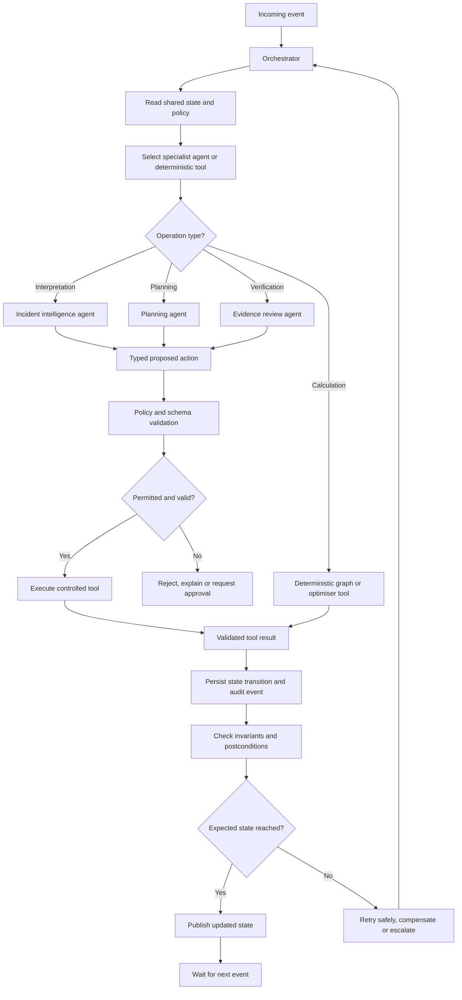
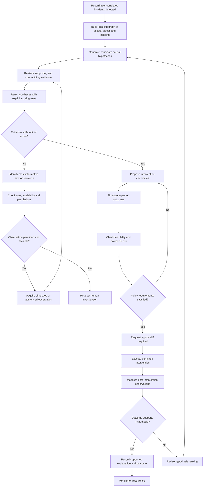
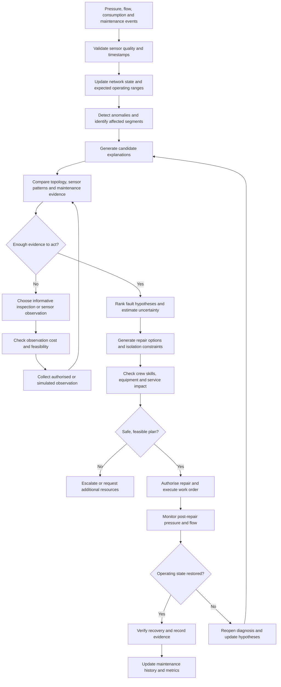
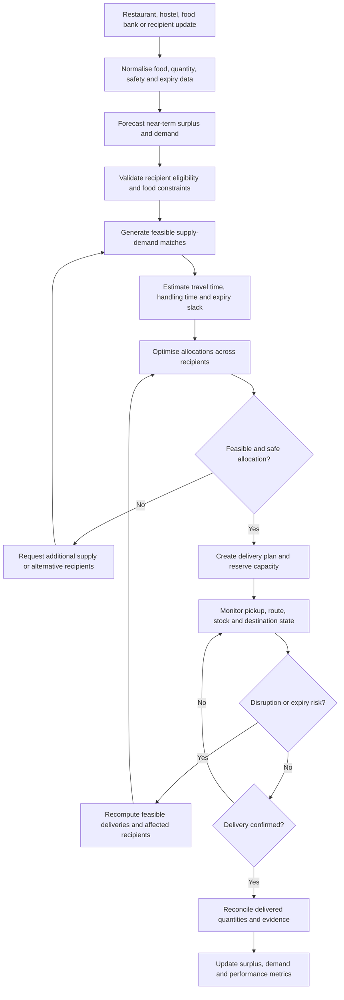
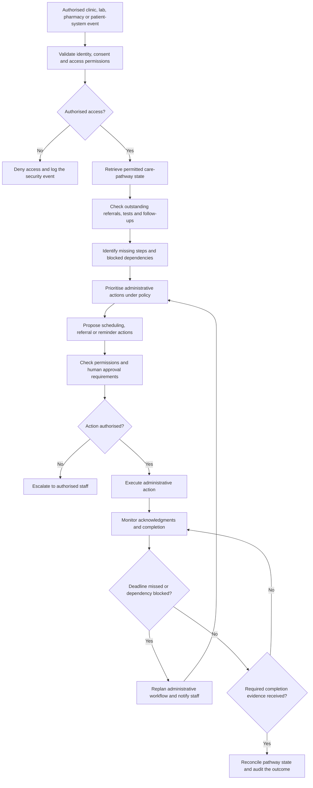
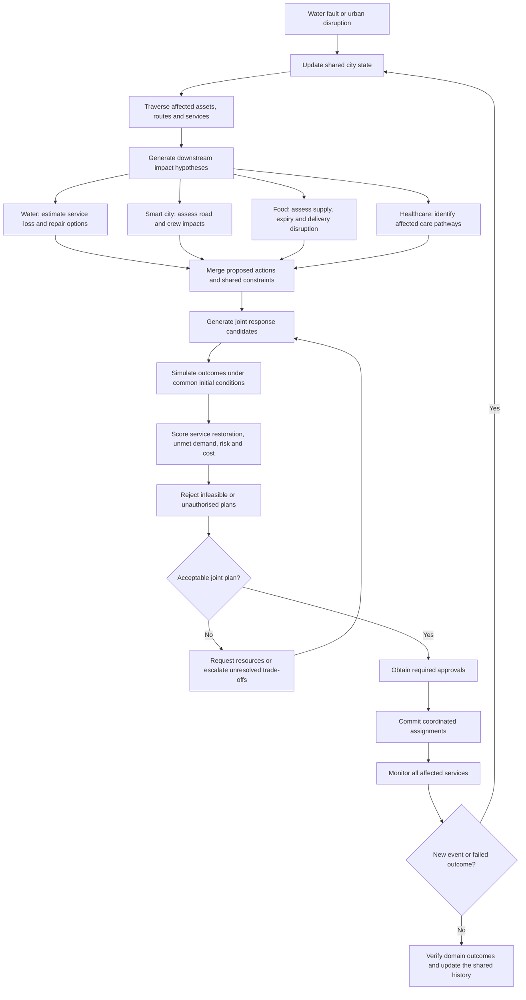

# CONVERGE flows

Seven process flows. **A is implemented** in the v1 backend. **B to G are design or roadmap**:
they describe where the platform is going, not what the code does today. Each flow says which.

Notes on A: the code simplifies some steps. Validation is schema-level (bad input is rejected with an
error, not quarantined for review). Location is a coordinate match, not a full asset lookup. Escalation
goes to a department head or the command centre, as described in the README.

## A. V1 incident loop (implemented)

## B. Agent orchestration (design)

## C. Root-cause investigation (design; shared-cause hypotheses are implemented in v2)

## D. Water module (roadmap)

## E. Food redistribution module (roadmap)

## F. Healthcare administration module (roadmap; administrative only, no clinical decisions)

## G. Cross-domain coordination (roadmap)

