# CONVERGE flows

This file has two parts.

- **Part 1: implemented.** What the code does today, with the real rule values from
  `backend/app/config.py` and `backend/app/engine/`. Every number here is in the code.
- **Part 2: design and roadmap.** Where the platform is going. These flows are plans, not built features.

Contents: [A1 Report intake](#a1-report-intake-and-grouping) ·
[A2 Assignment and deadlines](#a2-assignment-replanning-and-deadlines) ·
[A3 Verification](#a3-verification-and-closure) · [A4 Incident states](#a4-incident-state-machine) ·
[A5 Shared cause](#a5-shared-cause-repair-v2) · [A6 Citizen and operator](#a6-citizen-and-operator-loop) ·
[B–G roadmap](#part-2-design-and-roadmap)

# Part 1: implemented

## A1. Report intake and grouping

Where: `POST /reports` → `engine/intake.py`, `engine/dedup.py`, `engine/trust.py`.

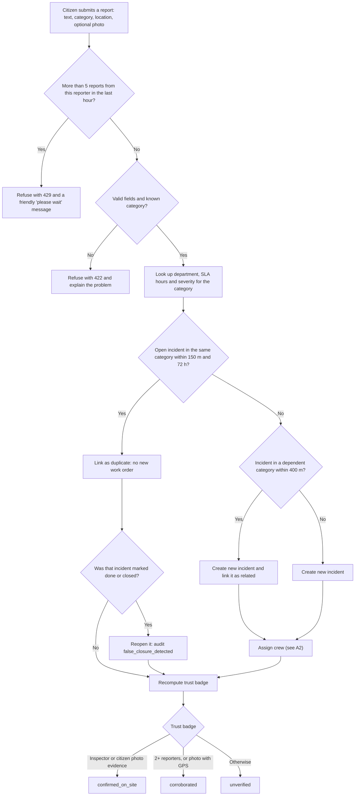

Dependent pairs (only these can be "related"): water leak ↔ pothole, sewage ↔ water leak, sewage ↔ pothole.

## A2. Assignment, replanning and deadlines

Where: `engine/assign.py`, `engine/sla.py`. The clock is simulated so deadlines can be demoed.

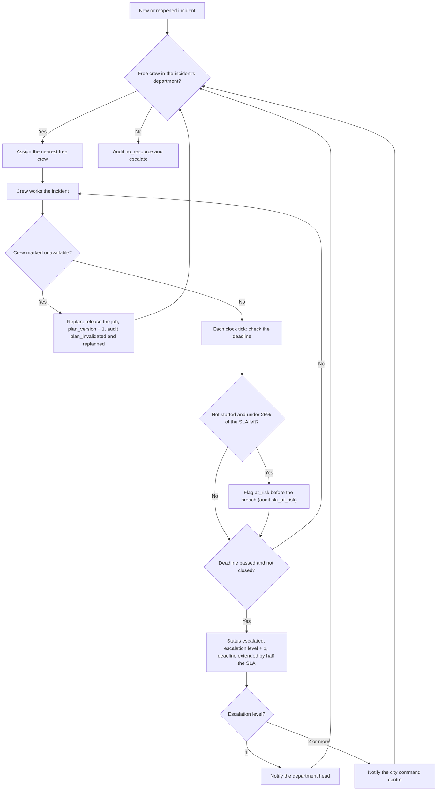

SLA hours: water leak 12, sewage 12, streetlight 24, garbage 24, pothole 48, other 72.

## A3. Verification and closure

Where: `engine/verify.py`. "Done" is never the same as "fixed".

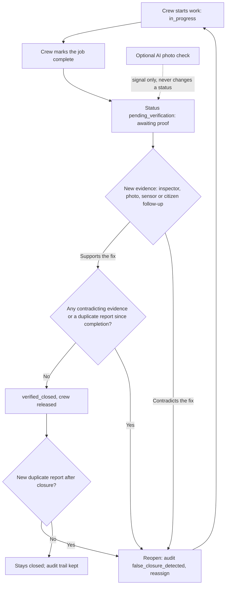

## A4. Incident state machine

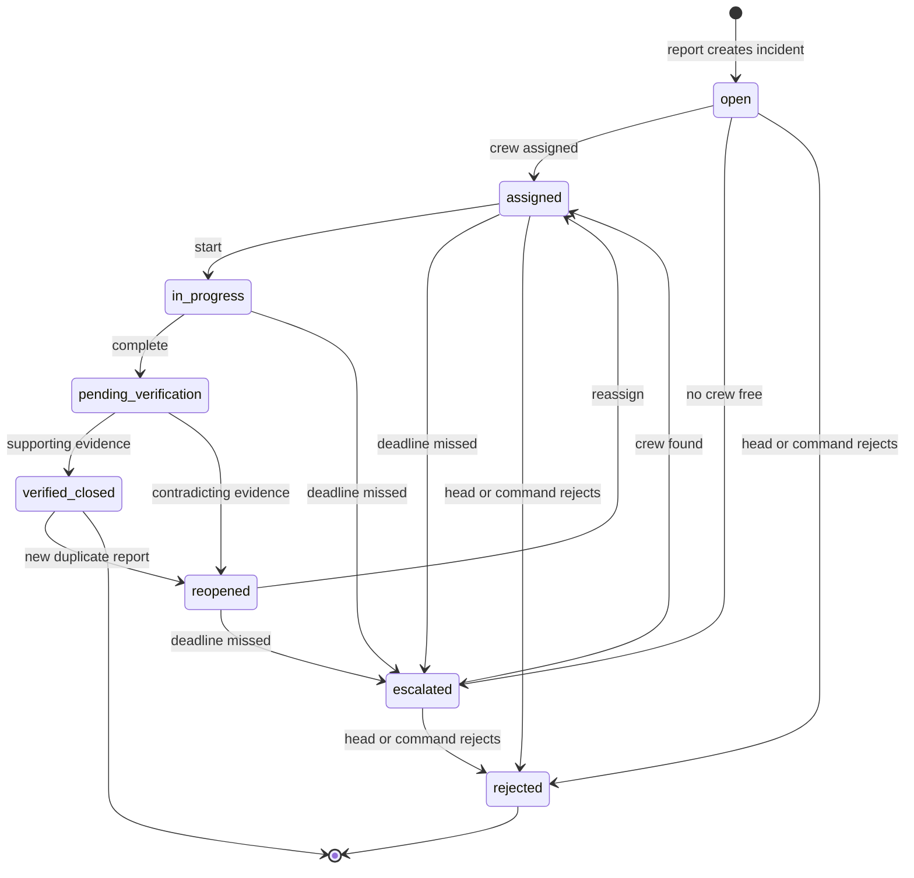

`rejected` needs a department head or the command centre, with a reason: `fake`, `not_civic`,
`cannot_locate` or `duplicate_elsewhere`. Officers get 403. Every transition writes an audit event.

## A5. Shared-cause repair (v2)

Where: `engine/rootcause.py`. Rules decide; an LLM may only write the summary sentence.

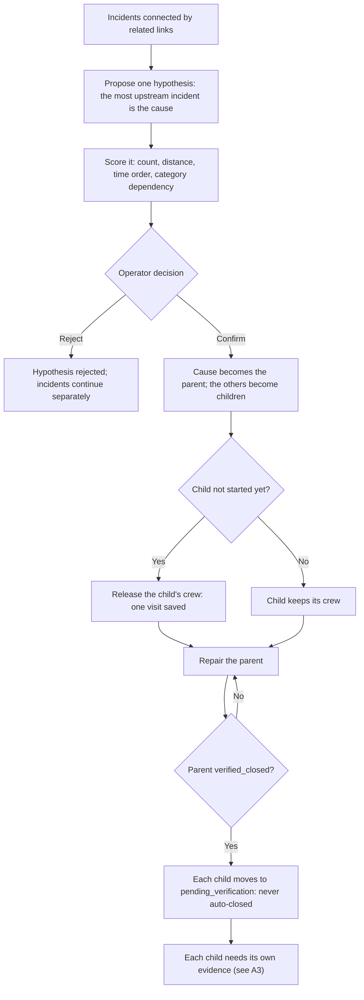

Upstream order: sewage, then water leak, then pothole. In the demo, crew visits go from 3 to 1.

## A6. Citizen and operator loop

Where: `frontend/src/app/citizen`, `frontend/src/app/track`, `frontend/src/app/operator`, `GET /citizen/activity`.

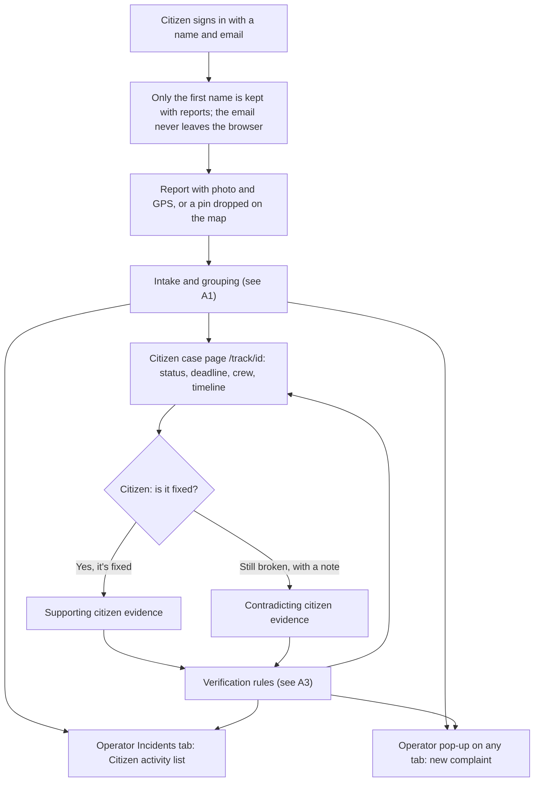

# Part 2: design and roadmap

The flows below are design work for later versions. They are **not** built features.

## B. Agent orchestration (design)

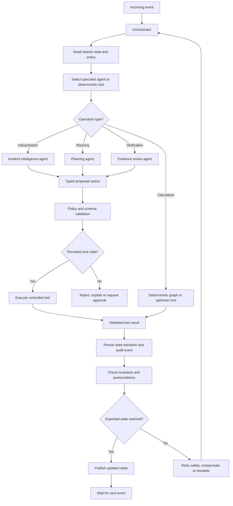

## C. Root-cause investigation (design; shared-cause hypotheses are implemented in v2)

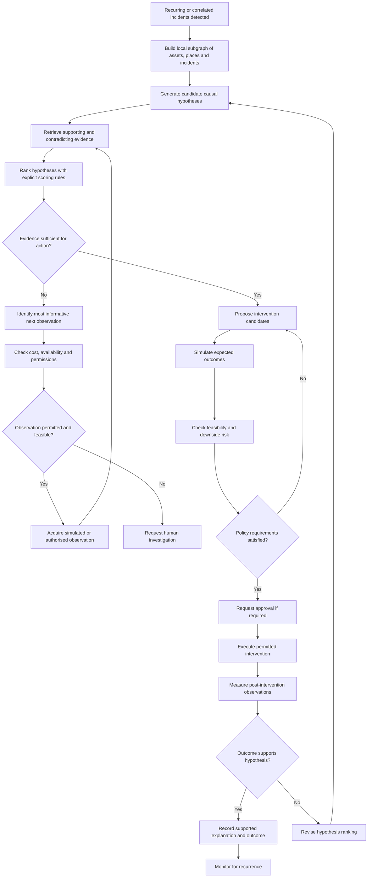

## D. Water module (roadmap)

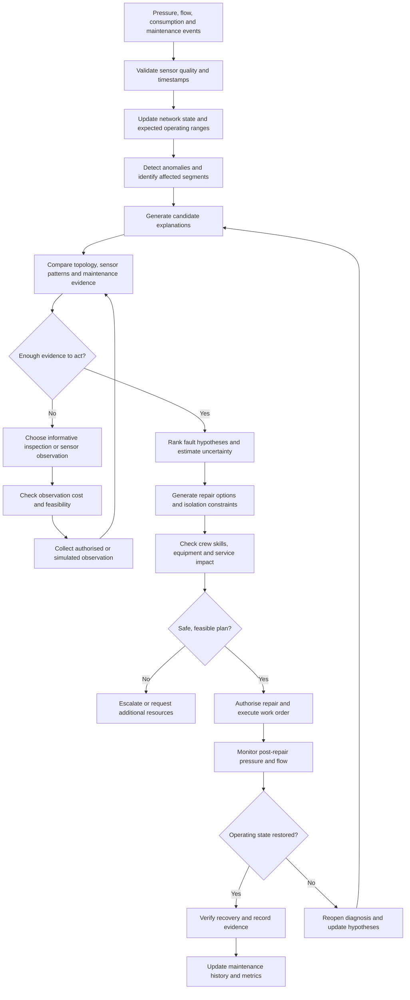

## E. Food redistribution module (roadmap)

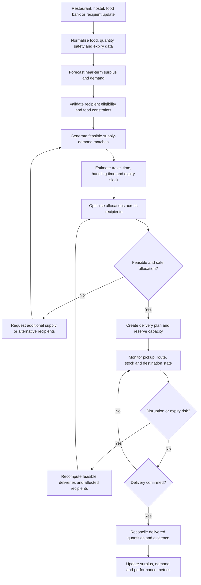

## F. Healthcare administration module (roadmap; administrative only, no clinical decisions)

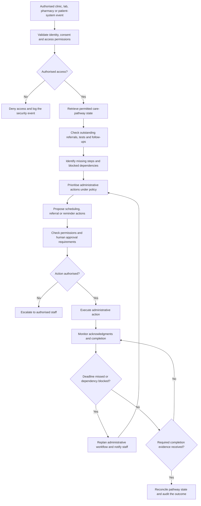

## G. Cross-domain coordination (roadmap)

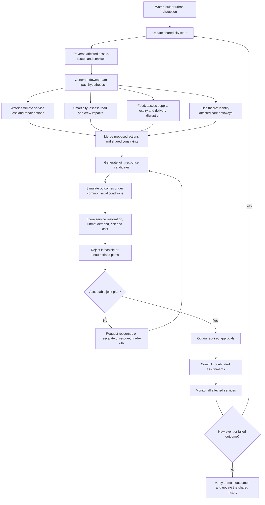
